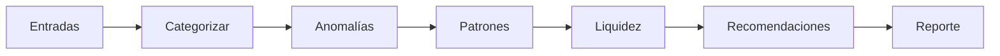

# pulso-ai

Motor de análisis financiero de **Pulso**, escrito en Python. Recibe las transacciones de un extracto, junto con su historial, y devuelve en streaming cada etapa del análisis y, al final, un reporte con categorías, anomalías explicadas, pagos recurrentes, gastos hormiga, proyección de liquidez y recomendaciones.

| Repositorio | Rol |
| --- | --- |
| [pulso-web](https://github.com/Jack-Limas/pulso-web) | Frontend Next.js |
| [pulso-api](https://github.com/Jack-Limas/pulso-api) | Backend, sesión y tiempo real; es el único cliente de este servicio |
| **pulso-ai** | Este repositorio |

La arquitectura completa y la topología de despliegue están en el README de `pulso-api`.

---

## Contrato de interfaz (`proto/pulso/ai/v1/analysis_engine_service.proto`)

```proto
service AnalysisEngineService {
  rpc AnalyzeStatement(AnalyzeStatementRequest) returns (stream AnalyzeStatementResponse);
}
```

| Mensaje | Contenido |
| --- | --- |
| `AnalyzeStatementRequest` | `entries` (historial de hasta 180 días con comercio normalizado), `current_balance_cents`, `period_end`, `locale` (`es` o `en`) y `known_categories`, las reglas que el usuario ya enseñó, por comercio |
| `AnalyzeStatementResponse` | `oneof event`: una `AnalysisStage` o el `AnalysisReport` final |
| `AnalysisReport` | `categorized_entries` (con método `RULE` o `MODEL`), `anomalies` (con `reason` y `score`), `recurring`, `ant_expenses`, `forecast` y `advice` |

- Toda llamada debe incluir el encabezado `x-internal-key`. El chequeo de salud es público.
- El dinero viaja en **centavos `int64`**.
- Los cambios al contrato deben ser aditivos; la copia de `pulso-api` debe actualizarse en el mismo momento.

### Dos transportes, un solo motor

| Entrada | Protocolo | Dónde se usa |
| --- | --- | --- |
| `python -m pulso_ai.server` | **gRPC nativo sobre HTTP/2**, con servicio estándar de salud gRPC | Docker y la demo local |
| `python -m pulso_ai.http_server` | **ConnectRPC sobre HTTP/1.1**, más `GET /health` | Render, porque su proxy no entrega HTTP/2 de extremo a extremo |

Ambos adaptadores (`analysis_engine.py`) envuelven el mismo `AnalysisEngine`. El adaptador Connect ejecuta cada etapa en un hilo aparte (`asyncio.to_thread`), porque el análisis usa CPU y puede esperar a Gemini; así no bloquea el bucle de eventos.

---

## Pipeline de análisis



| Etapa | Técnica | Archivo |
| --- | --- | --- |
| Categorización | **Strategy en cadena**: reglas del usuario → palabras clave → Gemini por lotes de 50 comercios. Cada comercio se consulta una sola vez | `categorization.py` |
| Anomalías | Cuatro detectores, cada uno con su **motivo** en español o inglés (tabla siguiente) | `anomalies.py` |
| Gastos hormiga | `Map` por comercio: al menos 4 compras de $20.000 o menos | `patterns.py` |
| Pagos recurrentes | Intervalos entre fechas cercanos a 7, 15 o 30 días (±3) y montos estables (±20 %) | `patterns.py` |
| Liquidez | Ritmo diario de ingresos y gastos proyectado a 30 días, más la pendiente de una **regresión lineal** sobre el saldo acumulado | `forecast.py` |
| Recomendaciones | Gemini escribe consejos a partir de totales; si falla o responde mal, se usan reglas | `advice.py` |

### Detección de anomalías

| Detector | Regla | Por qué así |
| --- | --- | --- |
| Monto atípico | **z-score modificado** con mediana y desviación absoluta mediana, umbral 3,5, y al menos el doble de la mediana de la categoría | Con pocos datos, un cobro enorme infla la media y la desviación lo suficiente para esconderse; la mediana casi no se mueve |
| Duplicado | Mismo comercio y valor en 2 días o menos | Doble cobro de una suscripción |
| Comisión nueva | Texto de comisión o sobregiro en un comercio que nunca había aparecido | Cargos bancarios inesperados |
| Isolation Forest | scikit-learn sobre valor y frecuencia, con al menos 30 gastos | Combinaciones raras que una sola regla no ve |

Antes de reportar un monto, cada gasto se compara también con **lo que esa persona suele pagar en ese mismo comercio**. Una categoría mezcla comercios muy distintos: un café y un pedido a domicilio son ambos "alimentación". Sin esta comparación, los pedidos normales aparecían como inusuales.

### Privacidad con Gemini

- Para categorizar, Gemini solo recibe **nombres de comercios**. Para recomendar, solo **totales agregados en pesos**. Nunca recibe nombres de personas, números de cuenta ni el PDF.
- Las respuestas se **validan**: una categoría fuera de la lista permitida se descarta. Así, un comercio con texto malicioso no puede inyectar una categoría.
- Si Gemini no está configurado, no responde o falla, el análisis termina igual con las reglas.

---

## Datos sintéticos para pruebas y demo

`scripts/generate_statements.py` crea extractos reproducibles de dos **bancos ficticios**, con formatos distintos a propósito:

| Banco | Fechas | Montos | Columnas |
| --- | --- | --- | --- |
| Banco Andino | `DD/MM/AAAA` | `1.234.567,89` con signo | Fecha, descripción, valor, saldo |
| Cooperativa Sur | `AAAA-MM-DD` | `$ 1,234,567.89` | Fecha, concepto, `CR`/`DB`, monto |

Cada perfil esconde hallazgos conocidos que el análisis debe encontrar:

| Perfil | Meses | Hallazgo sembrado |
| --- | --- | --- |
| estudiante | ago–oct | Consola de $1.850.000, café diario, Spotify |
| freelancer | ago–oct | Netflix cobrado dos veces, AWS mensual |
| pyme | ago–oct | Comisión por sobregiro nueva, nómina |
| familia | ago–oct | Mercado semanal y 7 pagos fijos |
| conductor | jun–oct | Taller mecánico de $2.400.000 |
| docente | jun–oct | SmartFit cobrado dos veces |
| medica | jun–oct | Tiquetes de $7.800.000 |
| emprendedora | jun–oct | Comisión de transferencia internacional |
| carga pesada | oct | 2.001 movimientos, para medir Web Worker contra hilo principal |

```bash
python scripts/generate_statements.py --out output
```

El mismo dato siempre produce los mismos bytes (`invariant=1`), así el hash del archivo es estable.

---

## Ejecutar en local

Requisitos: Python 3.12.

```bash
python -m venv .venv
.venv\Scripts\activate
pip install -r requirements-dev.txt
python scripts/generate_stubs.py
set INTERNAL_API_KEY=una-clave-de-al-menos-32-caracteres
set PYTHONPATH=src
python -m pulso_ai.http_server
```

### Variables de entorno

| Variable | Obligatoria | Descripción |
| --- | --- | --- |
| `INTERNAL_API_KEY` | Sí | Mínimo 32 caracteres; la misma `AI_INTERNAL_KEY` de `pulso-api` |
| `PORT` | No | 50051 por defecto |
| `GEMINI_API_KEY` | No | Sin ella se usan solo reglas |
| `GEMINI_MODEL` | No | `gemini-3.5-flash-lite` por defecto |

### Despliegue en Render

- Build: `pip install -r requirements-dev.txt && python scripts/generate_stubs.py`
- Start: `PYTHONPATH=src python -m pulso_ai.http_server`

### Pruebas

```bash
ruff check .
pytest        # 49 pruebas
```

Las pruebas cubren cada detector con casos positivos y negativos, la cadena de categorización (incluida la respuesta maliciosa del modelo), la proyección y los consejos con modelos simulados. También levantan **servidores reales de ambos transportes** y verifican el stream completo, la clave interna y el generador.
